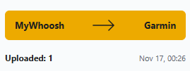

# MyWhoosh → Garmin

Chrome extension that uploads new MyWhoosh workouts to Garmin Connect.

## Install

1. Download or clone this repository.
2. Open `chrome://extensions` and enable **Developer mode**.
3. Click **Load unpacked** and select `browser-extension/`.

## Use

Click the extension icon, then **MyWhoosh → Garmin**. If a sign-in tab opens, complete login; the upload continues automatically.

**Uploaded** shows how many workouts were uploaded in the last run. Previously processed workouts are skipped.

Expand the arrow below the result for **Copy logs** and **Clear Cache**. Clearing the cache resets saved sign-in, processing history and logs; click again to confirm.
